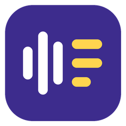
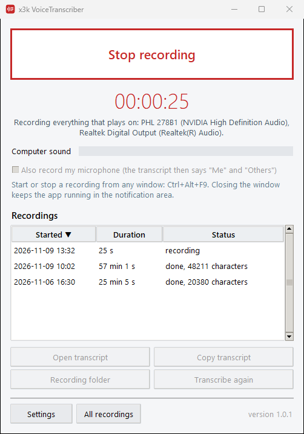

# x3k VoiceTranscriber

Record everything you hear on your Windows PC (a Zoom, Teams, Google Meet, Telegram or
Discord call, a webinar, a video) with one button, and get a written transcript from your own
NVIDIA GPU. The recordings and the transcripts never leave your computer: the speech
recognition runs on it.

## What it does

- **One button.** Press **Start recording** in the small window, press **Ctrl+Alt+F9** in any
  window, use the tray icon menu, or open a browser bookmark. The same action stops it.
- **Records what you hear, from any app.** The app captures the sound of your output devices
  (headphones, speakers, a Bluetooth headset), whichever program plays it. It records all
  active output devices at once, so a call that switches your Bluetooth headset to its
  hands-free mode is still captured, and it follows devices that connect or disconnect during
  the recording.
- **Optionally your microphone too.** Tick **Also record my microphone** and the transcript
  labels each paragraph **Me** or **Others**.
- **Transcript in seconds.** When you stop, the speech is transcribed by Whisper on your GPU.
  The transcript opens by itself and is already on the clipboard, ready to paste into notes,
  a document or a chat with an AI assistant.
- **Many languages.** Whisper detects the language of the recording by itself (about 100
  languages are supported); words and phrases in other languages inside the speech come out
  as they were said. You can also fix the language in the settings.
- **No length limit, safe against crashes.** Audio goes to disk as it is recorded. If the PC
  or the app stops mid-recording, the recording is transcribed on the next start.

Every recording gets its own folder in `Documents\VoiceTranscriber`:

| File | Content |
|---|---|
| `transcript.md` | the transcript: timestamped paragraphs, speakers when the microphone is on |
| `transcript.srt` | subtitles with exact times |
| `segments.json` | every recognized segment with start, end and text |
| `*.flac` | the audio, one file per device |

## Requirements

- **Windows 10 or 11, 64-bit.**
- **An NVIDIA GPU** for fast transcription, with a driver that supports CUDA 12 (version 528.33
  or newer). The CUDA libraries the app needs are included: no CUDA Toolkit to install.
- **GPU memory** for the model you choose (measured, see below):

  | Model | GPU memory | Download |
  |---|---|---|
  | large-v3 (most accurate, the default) | 4.6 GB, or 3.0 GB on cards below 8 GB | 3.1 GB |
  | large-v3-turbo (3x faster, nearly as accurate) | 2.5 GB, or 1.6 GB on cards below 8 GB | 1.6 GB |
  | small | 1.1 GB, or 0.8 GB on cards below 8 GB | 0.5 GB |

  On cards with less than 8 GB the app uses the int8 mode by itself: about a third less
  memory at the same accuracy. With several NVIDIA cards it picks the one with the most memory
  (you can choose another in the settings).
- **No NVIDIA GPU?** The app runs on the CPU too, slower: large-v3 transcribed about 2 times
  faster than real time on an Intel Core Ultra 7 265K, small about 10 times.
- **Disk:** about 1.2 GB for the program (most of it NVIDIA's cuBLAS library), plus the model,
  plus about 65 MB per hour of recorded speech.
- **Internet** once, to download the model. After that the app works offline; when online, it
  checks for updates and sends anonymous usage statistics (see [Privacy](#privacy)).

## Install

Download `x3k-VoiceTranscriber-<version>-setup.exe` (about 540 MB) from
[Releases](https://github.com/xyster3k/X3K-VoiceTranscriber/releases/latest) and run it. It
installs for your Windows user only, without administrator rights, adds Start menu and desktop
shortcuts, and can be removed in **Settings > Apps**.

The program is not signed with a paid code-signing certificate, so Windows SmartScreen may
say "Windows protected your PC" on the first start. Click **More info**, then **Run anyway**.

On the first transcription the app downloads the Whisper model you chose (3.1 GB for
large-v3) from Hugging Face; the recordings list shows the download progress. After that it
works offline.

## Updates

The app checks this repository for a new release when it starts and every 6 hours. When there
is one, it asks whether to update now. **Yes** downloads the installer, checks it against the
SHA-256 checksum GitHub publishes for the file, installs it over the current version and starts
the app again; your settings and recordings stay. **Later** asks again at the next check. The
question never interrupts a recording or a transcription.

## Use

1. Start the app. A small window stays on top of other windows; closing it keeps the app in
   the notification area.
2. Press **Start recording** (or **Ctrl+Alt+F9**). The green bar shows the sound being
   recorded.
3. Press **Stop recording**. A few seconds later the transcript opens, and its text is on the
   clipboard.

The **Recordings** list shows every recording with its status; you can open, copy or
transcribe a recording again from there.

## Settings

| Setting | What it does |
|---|---|
| Recordings folder | where the recording folders go |
| Record from | all output devices (recommended), or one device |
| Microphone | which microphone to record when the microphone is on |
| Speech language | detect automatically, or always one language |
| Model | large-v3, large-v3-turbo or small (see [Speed and GPU memory](#speed-and-gpu-memory)) |
| Transcribe on | the GPU with the most memory (automatic), a chosen GPU, or the CPU |
| Names and terms | words the transcript should spell your way (names, products, jargon) |
| Hotkey | the global shortcut, Ctrl+Alt+F9 by default |
| Open / copy the transcript | what happens when a transcript is ready |
| Keep the window on top, Start with Windows | window and autostart |
| Send anonymous usage statistics | on by default; what is sent is listed under [Privacy](#privacy) |
| Browser bookmark | a local link that starts or stops a recording |

## Speed and GPU memory

Measured with the app's own transcription settings (beam size 5, voice activity filter) on
15 minutes of continuous English speech from the
[LibriSpeech test-clean](https://www.openslr.org/12) set, 91 utterances by 40 speakers.
"Speed" is minutes of audio per minute of work: 20x means an hour of speech in 3 minutes.
Meetings have pauses, which are skipped, so a real call is usually transcribed faster.
"Word error rate" is the share of words that differ from the reference text, after
lowercasing and removing punctuation.

| Model | Mode | GPU memory | Speed, RTX 3090 | Speed, RTX 5090 | Word error rate |
|---|---|---|---|---|---|
| large-v3 | float16 | 4.6 GB | 20x | 13x | 2.0% |
| large-v3 | int8 | 3.0 GB | 20x | 17x | 2.0-2.1% |
| large-v3-turbo | float16 | 2.5 GB | 60x | 67x | 3.7-6.5% |
| large-v3-turbo | int8 | 1.6 GB | 62x | 68x | 2.1-2.2% |
| small | float16 | 1.1 GB | 45x | 47x | 6.4% |
| small | int8 | 0.8 GB | 43x | 42x | 3.7-5.4% |

Two numbers in the error column are the two GPUs. Both GPUs drove a working desktop with
other applications at the time of the test, as they would on your PC; the RTX 5090 was the
busier one, which is why it is not faster for large-v3. Load time of a model: 1-5 seconds.

On the CPU (Intel Core Ultra 7 265K, int8 mode, 3 minutes of the same speech set):

| Model | Speed | Word error rate |
|---|---|---|
| large-v3 | 2.2x | 1.1% |
| large-v3-turbo | 3.9x | 2.3% |
| small | 9.7x | 2.3% |

## Privacy

- Audio and transcripts stay in your recordings folder. They are never sent anywhere.
- Network access: the one-time model download from Hugging Face, the update check, which
  reads this repository's latest release from the GitHub API, and the anonymous usage
  statistics described below.
- Anonymous usage statistics go to `stats.deniatech.com` at the first start on a computer,
  after an update and at most once a day while the app runs. Each message holds a random
  install number created by the app, the app version (and the previous one after an update),
  the Windows version, the names and memory of the NVIDIA GPUs, and the chosen model and
  device. The server stores the country Cloudflare reports for the connection; it does not
  store the IP address. Audio, transcripts, file names, user and computer names are never
  sent. To turn the statistics off, clear **Send anonymous usage statistics** in **Settings**.
- The browser bookmark works only on your own computer (`127.0.0.1`) and carries a random key.

## Troubleshooting

- **The green bar stays empty while sound plays.** Windows hands the app the sound after the
  volume control: a muted device, or one at zero volume, is recorded as silence. The app warns
  you when every output device is muted.
- **The hotkey does nothing.** Another program uses the same shortcut; the window tells you so.
  Choose another one in **Settings**.
- **The transcription uses the CPU and is slow.** The app could not load the model on the GPU:
  update the NVIDIA driver, or choose a smaller model.
- **Logs** for a bug report: `%LOCALAPPDATA%\VoiceTranscriber\logs`, and `log.txt` in the
  recording folder.

Questions and bug reports: [Issues](https://github.com/xyster3k/X3K-VoiceTranscriber/issues).

## License

x3k VoiceTranscriber is free to use, for personal and commercial purposes; see
[LICENSE.txt](LICENSE.txt). It is built on open-source components, listed with their licenses
in [THIRD-PARTY-NOTICES.txt](THIRD-PARTY-NOTICES.txt). Speech recognition: OpenAI Whisper
through [faster-whisper](https://github.com/SYSTRAN/faster-whisper) and
[CTranslate2](https://github.com/OpenNMT/CTranslate2).

Laws on recording conversations differ between countries; some require the consent of every
participant. Make sure you are allowed to record.
